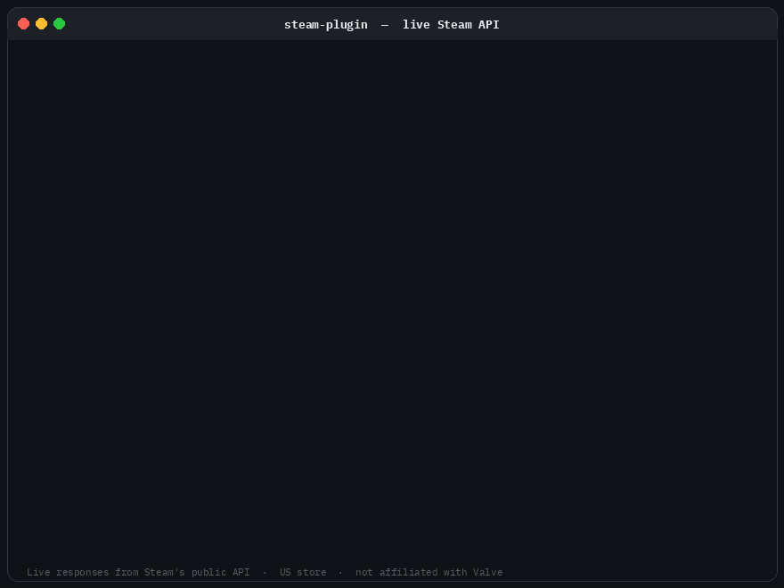

# Steam plugin

Look up any Steam game from your editor: US store price, live player count, review score, and latest news. No API key.

[](https://cursor.directory/plugins/steam)
[](LICENSE)
[](https://modelcontextprotocol.io)

A zero-dependency Node.js MCP server (Node 18 or newer) plus a Cursor skill. It only calls Steam's public, unauthenticated endpoints, and it is read-only.

Built by [Hollow Wick Games](https://hollowwickgames.com) while making Last Light: Waxmourn.



## What it does

| Tool | Arguments | Returns |
|---|---|---|
| `search_games` | `query` | `[{ appid, name, price }]` — resolve a game name to its appid |
| `get_game` | `appid` | `{ appid, name, type, isFree, price{final, initial, discountPercent, currency, formatted}, releaseDate{comingSoon, date}, developers, publishers, genres, platforms, shortDescription, storeUrl }` |
| `get_player_count` | `appid` | `{ appid, currentPlayers }` |
| `get_reviews` | `appid` | `{ appid, scoreDescription, totalPositive, totalNegative, totalReviews }` |
| `get_news` | `appid`, `count` (1–10, default 5) | `[{ title, url, author, date (ISO 8601, or null if Steam gives none), excerpt }]` |

## Example prompts

- How many people are playing Counter-Strike 2 right now?
- What's Hades' review score and price?
- Show the latest news for appid 1145360.

## Install in Cursor

The easiest path is the listing on [cursor.directory](https://cursor.directory/plugins/steam).

To add the server by hand, clone this repo and put the following in Cursor's MCP config (`~/.cursor/mcp.json`), using your real path:

```json
{
  "mcpServers": {
    "steam": {
      "command": "node",
      "args": ["/absolute/path/to/steam-plugin/server/index.mjs"]
    }
  }
}
```

Requires Node.js 18 or newer. There is nothing to `npm install`.

Or install it as a local Cursor plugin (MCP server plus the bundled skill):

```bash
git clone https://github.com/tonygskrum-ux/steam-plugin.git
mkdir -p ~/.cursor/plugins/local
ln -s "$(pwd)/steam-plugin" ~/.cursor/plugins/local/steam
```

Reload Cursor afterward.

## Other MCP clients

The server speaks MCP over stdio. Point any client at `node /absolute/path/to/steam-plugin/server/index.mjs`. For Claude Desktop, add this to `claude_desktop_config.json` (macOS: `~/Library/Application Support/Claude/`; Windows: `%APPDATA%\Claude\`):

```json
{
  "mcpServers": {
    "steam": {
      "command": "node",
      "args": ["/absolute/path/to/steam-plugin/server/index.mjs"]
    }
  }
}
```

The same stdio snippet works in other MCP clients, including Claude Code, with their own config paths.

## Notes and limits

- **Prices are from the US store** (`cc=us`), in USD. Prices and availability differ by region.
- `price` is `null` for free-to-play games and for games with no price set.
- Player counts are a live snapshot, not a peak or an average.
- Review totals count all languages and all purchase types.
- If `get_reviews` cannot fetch a summary, the appid may not exist or may have no reviews. Confirm the appid with `get_game`.
- Steam rate-limits its public endpoints. If you get HTTP 429, wait a minute.

## Tests

```bash
node --test
```

The tests stub `fetch`, so they never call Steam and need nothing installed.

## Data source and disclaimer

All data comes live from Steam's public web endpoints (`store.steampowered.com` and `api.steampowered.com`). This project is **not affiliated with, endorsed by, or sponsored by Valve Corporation**. Steam and the Steam logo are trademarks of Valve Corporation.

## License

MIT © 2026 Anthony Krum
